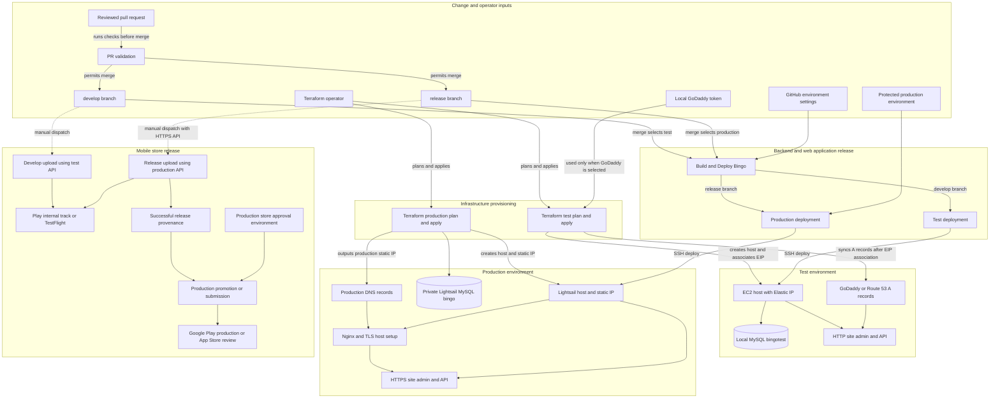
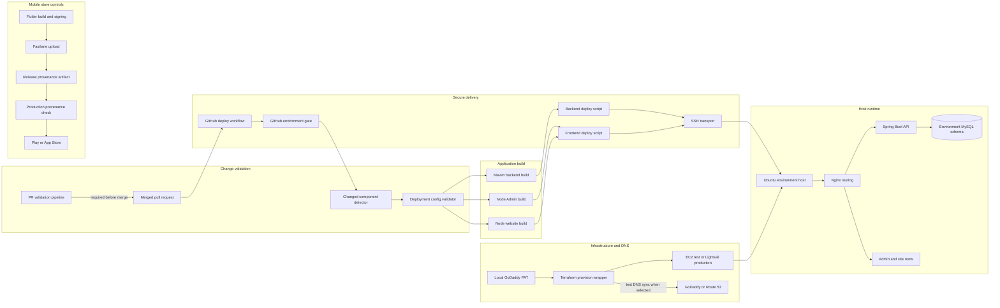

# Architecture Diagram

This deployment architecture shows how infrastructure is provisioned separately
from application releases, and how the test and production environments differ.
Mobile store uploads are separate manual workflows with production provenance
checks before promotion or App Store submission.

## Application Architecture

<!-- mermaid-checked: no \n, no em-dash/en-dash, no {} in labels, subgraphs are id["label"], arrows are -->|"label"|, all subgraphs closed by end, ids unique -->

### Deployment sequence

| Lane | Flow |
|---|---|
| Test infrastructure | Create `env/test.tfvars`, run `./provision.sh test plan`, review, then apply. Terraform creates EC2, local MySQL, Nginx, and an Elastic IP. It syncs the three test A records through GoDaddy when `route53_zone_id` is empty, or creates Route 53 records when it is set. DNS records are not deleted on destroy. |
| Test application | Create and configure the GitHub `test` Environment. After PR validation, merge to `develop`; `deploy.yml` validates settings, builds changed backend/Admin/site components, and deploys them over SSH. Test uses schema `bingotest`, API port `8091`, and HTTP origins. |
| Production infrastructure | Create `env/prod.tfvars`, provide `TF_VAR_database_admin_password` securely, run `./provision.sh prod plan`, review, then apply. Terraform creates the Lightsail host, static IP, private MySQL database, and a Secrets Manager placeholder. Production DNS and HTTPS host setup are separate steps. |
| Production application | Create and protect the GitHub `production` Environment. After PR validation, merge to `release`; the deployment job waits for required environment approval before deploying changed components over SSH. Production uses schema `bingo`, API port `8081`, HTTPS, and verified database TLS. |
| Mobile testing | Manually dispatch Android internal testing or iOS TestFlight from `develop`; the default backend is `http://api.test.bakaroo.com`. |
| Mobile production | Dispatch the upload workflow from `release` with `https://api.bingo.bakaroo.com`. The workflow records provenance. Android promotion and iOS App Store submission verify that provenance and require their production environment approvals. |

**Production database gate:** the current repository-level `MYSQL_HOST` is an
RDS endpoint, but the Terraform production stack creates a Lightsail MySQL
database. The application workflow does not migrate data or create a
production application account. Select and verify the production database
target, app user, grants, credentials, migration, and rollback plan before
pointing the production deployment at the Terraform output.

### Technology Stack Summary

| Layer | Technology | Version | Purpose |
|---|---|---|---|
| CI and deployment | GitHub Actions | Workflow managed | PR checks, builds, SSH deployments, and manual store workflows |
| Infrastructure | Terraform and AWS provider | Terraform `>= 1.1.0`, AWS provider `~> 5.0` | Provisions test EC2 and production Lightsail resources |
| Test host | Ubuntu, EC2, Nginx, MySQL | Ubuntu 24.04, `t3.micro`, MySQL 8 | HTTP test site and backend with local database |
| Production host | Ubuntu, Lightsail, Nginx, MySQL | Ubuntu 24.04, MySQL 8 | HTTPS production services and private managed database |
| Backend | Java, Spring Boot, Maven | Java 25, Spring Boot 4.1.1 | REST and WebSocket API |
| Admin | React, TypeScript, Vite | React 18, TypeScript 5, Node 22.22.0 | Admin single-page application |
| Public website | Astro, TypeScript | Astro 5, Node 22.22.0 | Public website |
| Mobile | Flutter and Fastlane | Flutter 3.47.7, Fastlane 2.241.1 | Android and iOS store artifacts and promotion |
| DNS | GoDaddy Domains API or AWS Route 53 | GoDaddy API v3 | Test A records; production DNS is separately configured |

### Data Storage & External Services

Test stores data in the `bingotest` MySQL schema on the EC2 host, bound to
loopback. Production uses the `bingo` schema in a private Lightsail MySQL
database with TLS identity verification. GitHub Actions supplies application
secrets at deployment time. Terraform state can contain sensitive production
resource attributes, so it must be protected and encrypted. GoDaddy DNS sync
uses `GODADDY_PAT` from the local Terraform process; the token is not a Terraform
variable or state value. No message broker or shared cache is part of this
deployment path.

### Key Architectural Decisions

- Infrastructure provisioning and application deployment are separate
  operations; application workflows never apply Terraform.
- Test is HTTP-only and isolated from production hostnames and data. Production
  is HTTPS-only and uses database TLS identity verification.
- Mobile store publication is manual and separate from web/backend deployment.
  Production promotion or submission requires a matching successful
  release-branch upload provenance record.

## Component Relationships

<!-- mermaid-checked: no \n, no em-dash/en-dash, no {} in labels, subgraphs are id["label"], arrows are -->|"label"|, all subgraphs closed by end, ids unique -->

### Component Inventory

| Component | Layer | Type | Responsibility |
|---|---|---|---|
| PR validation pipeline | Validation | GitHub Actions workflow | Tests the proposed change before merge |
| Build and Deploy Bingo | Delivery | GitHub Actions workflow | Selects test or production from the branch and deploys selected applications |
| Changed component detector | Validation | Python script | Limits builds and deployments to changed components |
| Deployment config validator | Validation | Python script | Checks environment-specific origins, bootstrap, and email settings |
| Maven backend build | Build | Maven | Produces the Spring Boot JAR |
| Admin and website builds | Build | Node toolchains | Produce static deployment artifacts |
| Backend deploy script | Delivery | Bash and SSH | Validates runtime configuration, preflights migrations, deploys and health-checks the JAR |
| Frontend deploy script | Delivery | Bash and SSH | Preflights public URLs and replaces selected static roots with backups |
| Terraform provision wrapper | Infrastructure | Bash and Terraform | Selects the environment workspace and applies reviewed infrastructure plans |
| GoDaddy DNS updater | Infrastructure | Python and HTTPS API | Creates or updates test A records without deleting them on destroy |
| Nginx | Runtime | Reverse proxy and static server | Serves the public origins and proxies API traffic to loopback |
| Spring Boot API | Runtime | Java service | Serves REST and WebSocket requests |
| MySQL schema | Data | MySQL database | Stores test `bingotest` or production `bingo` data |
| Mobile upload workflows | Release | Flutter and Fastlane | Builds and uploads internal testing or TestFlight artifacts |
| Release provenance check | Release gate | Python verification | Rejects test-backend builds from production promotion or submission |
